# Práctica 1: Servidor de base de datos con Docker (PostgreSQL 16.4)

Documentación completa del despliegue, la configuración y el control de acceso de un servidor PostgreSQL para una empresa ficticia con un ERP y personal que trabaja directamente con la base de datos.

- **Autor:** Sergio Herraiz
- **Módulo:** Administración de Sistemas Gestores de Bases de Datos (ASGBD), ASIX
- **Curso:** 2026-2027
- **SGBD elegido:** PostgreSQL 16.4
- **Contenedor:** `empresa-db`
- **Proyecto Compose:** `asgbd-p1`

---

## Tabla resumen

| Requisito | Cómo se ha resuelto | Evidencia |
|---|---|---|
| **1. Despliegue reproducible** | `docker-compose.yml` con imagen `postgres:16.4`, 2 redes, 4 volúmenes y límite de 2 GB. Contraseñas en `.env` (ignorado por Git). Todo se monta con `setup-env.sh` | [Apartado 1](#apartado-1) |
| **2. Acceso restringido a la red interna** | `pg_hba.conf` con `reject` explícito para `172.31.0.0/24`. Servidor en las dos redes y sin puertos publicados | [Apartado 2](#apartado-2) |
| **3. Memoria** | `shared_buffers` 512 MB, `work_mem` 4 MB, `maintenance_work_mem` 32 MB, `wal_buffers` 16 MB. Peor caso calculado: 1827 MB de 2048 MB | [Apartado 3](#apartado-3) |
| **4. Conexiones** | `max_connections = 55` (50 necesarias + 3 reservadas + 2 de margen) | [Apartado 4](#apartado-4) |
| **5. Almacenamiento** | Tablespaces `tbs_erp` y `tbs_empleados` en volúmenes distintos | [Apartado 5](#apartado-5) |
| **6. Trazabilidad** | `logging_collector` escribe en un volumen persistente. Los rechazos quedan registrados | [Apartado 6](#apartado-6) |
| **7. Cuenta de la aplicación** | `erp_app` con solo DML, límite de 45 conexiones y sin caducidad. Propietarios `NOLOGIN` | [Apartado 7](#apartado-7) |
| **8. Acceso del personal** | Roles `rol_rrhh` y `rol_analista`. Privilegio por columna para ocultar el salario. Caducidad a 90 días | [Apartado 8](#apartado-8) |
| **9. Ampliación: caída súbita** (opcional) | Reinicio automático configurado. Tras una caída simulada se conserva lo confirmado y se descarta lo no confirmado. Con `synchronous_commit = off` se reproduce la pérdida de una transacción confirmada | [Apartado 9](#apartado-9) |

---

## Convenciones de este documento

- Los comandos se ejecutan desde la carpeta `p1/` con las variables del `.env` cargadas:

  ```bash
  set -a; source .env; set +a
  ```

- Las contraseñas aparecen siempre como variables (`$ERP_APP_PASSWORD`), nunca con su valor real.
- Las salidas que se muestran son **texto copiado de la terminal**, obtenido consultando al servidor. Las capturas de la carpeta `img/` son un apoyo visual.
- En Git Bash las rutas que empiezan por `/` se convierten a rutas de Windows. Por eso los comandos que usan rutas del contenedor van dentro de `sh -c '...'`, lo que además los hace portables a Linux.
- Cuando una captura no recoge todas las líneas de un bloque de comandos, se indica expresamente.

---

<a id="apartado-0"></a>
## 0. Decisiones generales

### Por qué PostgreSQL

| Criterio | Decisión |
|---|---|
| Peso de la imagen y arranque | La imagen oficial de PostgreSQL es considerablemente más pequeña que las de Oracle y arranca antes. No se ha medido en esta práctica |
| Control de acceso por red | `pg_hba.conf` encaja directamente con el requisito 2: el rechazo lo decide el SGBD |
| Tablespaces | Se crean con una sola sentencia apuntando a un directorio |
| Roles y privilegios | Los roles son el mecanismo nativo de grupos de privilegios, y admite privilegios por columna |
| Licencia | Libre, sin restricciones para una práctica |

### Estructura del repositorio

```text
p1/
├── README.md
├── docker-compose.yml
├── setup-env.sh
├── .env.example
├── conf/
│   ├── postgresql.conf
│   └── pg_hba.conf
├── sql/
│   ├── 01-estructura.sql
│   └── 02-roles-privilegios.sql
└── img/
```

Ficheros principales: [`docker-compose.yml`](docker-compose.yml), [`setup-env.sh`](setup-env.sh), [`conf/postgresql.conf`](conf/postgresql.conf), [`conf/pg_hba.conf`](conf/pg_hba.conf), [`sql/01-estructura.sql`](sql/01-estructura.sql) y [`sql/02-roles-privilegios.sql`](sql/02-roles-privilegios.sql).

### Fichero `.env.example`

```bash
POSTGRES_PASSWORD=cambiame
ERP_APP_PASSWORD=cambiame
INITIAL_USER_PASSWORD=cambiame
```

---

<a id="apartado-1"></a>
## 1. Despliegue reproducible

**Necesidad:** si el servidor se pierde, debe poder recrearse rápido y con los mismos datos.

### 1.1 `docker-compose.yml`

```yaml
name: asgbd-p1

services:
  init-perms:
    image: alpine:3.20
    user: root
    command: chown -R 999:999 /tbs/erp /tbs/empleados /logs
    volumes:
      - vol_erp:/tbs/erp
      - vol_empleados:/tbs/empleados
      - vol_logs:/logs

  db:
    container_name: empresa-db
    image: postgres:16.4
    restart: unless-stopped
    command: ["postgres", "-c", "config_file=/etc/postgresql/postgresql.conf"]
    environment:
      POSTGRES_PASSWORD: ${POSTGRES_PASSWORD}
    depends_on:
      init-perms:
        condition: service_completed_successfully
    mem_limit: 2g
    memswap_limit: 2g
    shm_size: 512m
    networks: [interna, visitantes]
    volumes:
      - ./conf:/etc/postgresql:ro
      - vol_pgdata:/var/lib/postgresql/data
      - vol_erp:/tablespaces/erp
      - vol_empleados:/tablespaces/empleados
      - vol_logs:/var/log/postgresql
    healthcheck:
      test: ["CMD-SHELL", "pg_isready -h 127.0.0.1 -U postgres"]
      interval: 2s
      timeout: 5s
      retries: 30
      start_period: 10s

networks:
  interna:
    name: p1_interna
    ipam:
      config:
        - subnet: 172.30.0.0/24
  visitantes:
    name: p1_visitantes
    ipam:
      config:
        - subnet: 172.31.0.0/24

volumes:
  vol_pgdata:
  vol_erp:
  vol_empleados:
  vol_logs:
```

### 1.2 Justificación de cada decisión

| Decisión | Motivo |
|---|---|
| `postgres:16.4` | Versión fijada, nunca `latest`, para que el despliegue sea reproducible |
| 4 volúmenes | Datos del servidor, ERP, empleados y logs separados, como exige el enunciado |
| Sin `ports:` | No se publica ningún puerto en el host |
| `mem_limit: 2g` | El contenedor no puede usar más de los 2 GB del enunciado |
| `memswap_limit: 2g` | Sin swap: si se supera la memoria, Docker mata el contenedor y el límite es real |
| `shm_size: 512m` | PostgreSQL usa `/dev/shm` y los 64 MB por defecto se quedan cortos |
| `init-perms` | Los volúmenes nuevos pertenecen a root. PostgreSQL exige que los directorios de tablespaces y logs sean del usuario `postgres` (uid 999) |
| Subredes fijas | Reproducen las del enunciado: `172.30.0.0/24` y `172.31.0.0/24` |
| `restart: unless-stopped` | Reinicio automático si el proceso cae (ampliación) |
| `healthcheck` por TCP | Durante la inicialización el servidor temporal solo escucha por socket Unix, por lo que se comprueba por `127.0.0.1` |
| Conf montada como solo lectura | La configuración vive en el repositorio y el contenedor no puede alterarla |

### 1.3 Contraseñas fuera del repositorio

`.gitignore` (raíz del repositorio):

```text
.env
**/.env
.DS_Store
Thumbs.db
.vscode/
.idea/
```

```bash
git check-ignore -v p1/.env
git status
```

La primera orden indica qué línea de `.gitignore` ignora el fichero (`**/.env`), y `git status` confirma que no hay nada pendiente de subir.

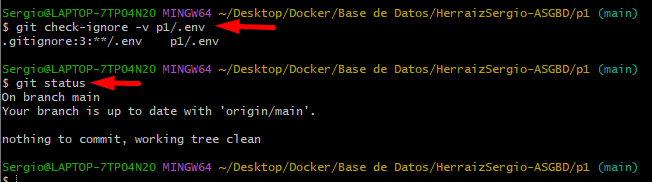

### 1.4 Script `setup-env.sh`

```bash
#!/usr/bin/env bash
set -euo pipefail
cd "$(dirname "$0")"

[ -f .env ] || { echo "Falta .env (copia .env.example a .env)"; exit 1; }
set -a; source .env; set +a

### CONTENEDORES
docker compose up -d --wait

### SQL
PSQL=(docker exec -i empresa-db psql -U postgres -v ON_ERROR_STOP=1
      -v erp_pwd="$ERP_APP_PASSWORD" -v user_pwd="$INITIAL_USER_PASSWORD")

# Idempotente: solo inicializa si la base de datos no existe
if [ "$("${PSQL[@]}" -tAc "SELECT 1 FROM pg_database WHERE datname='empresa'")" != "1" ]; then
  for f in sql/0*.sql; do
    echo ">> Ejecutando $f"
    "${PSQL[@]}" < "$f"
  done
else
  echo "La base de datos 'empresa' ya existe: se omite la inicialización."
fi

echo "Entorno listo."
```

**Por qué es idempotente:** si se lanza dos veces, la segunda detecta que `empresa` existe y no intenta recrear roles y tablespaces (daría error).

### 1.5 Evidencia: montaje desde cero

```bash
docker compose down -v
./setup-env.sh
```

```text
[+] down 9/9
 ✔ Container empresa-db            Removed
 ✔ Container asgbd-p1-init-perms-1 Removed
 ✔ Network asgbd-p1_default        Removed
 ✔ Volume asgbd-p1_vol_pgdata      Removed
 ✔ Network p1_visitantes           Removed
 ✔ Network p1_interna              Removed
 ✔ Volume asgbd-p1_vol_logs        Removed
 ✔ Volume asgbd-p1_vol_empleados   Removed
 ✔ Volume asgbd-p1_vol_erp         Removed

[+] up 9/9
 ✔ Network asgbd-p1_default        Created
 ✔ Volume asgbd-p1_vol_empleados   Created
 ✔ Network p1_visitantes           Created
 ✔ Network p1_interna              Created
 ✔ Volume asgbd-p1_vol_pgdata      Created
 ✔ Volume asgbd-p1_vol_logs        Created
 ✔ Volume asgbd-p1_vol_erp         Created
 ✔ Container asgbd-p1-init-perms-1 Exited
 ✔ Container empresa-db            Healthy
>> Ejecutando sql/01-estructura.sql
...
>> Ejecutando sql/02-roles-privilegios.sql
...
Entorno listo.
```

(Se omiten las líneas `CREATE ...`, `GRANT ...` y `INSERT ...` que imprime `psql`; aparecen completas en la captura.)

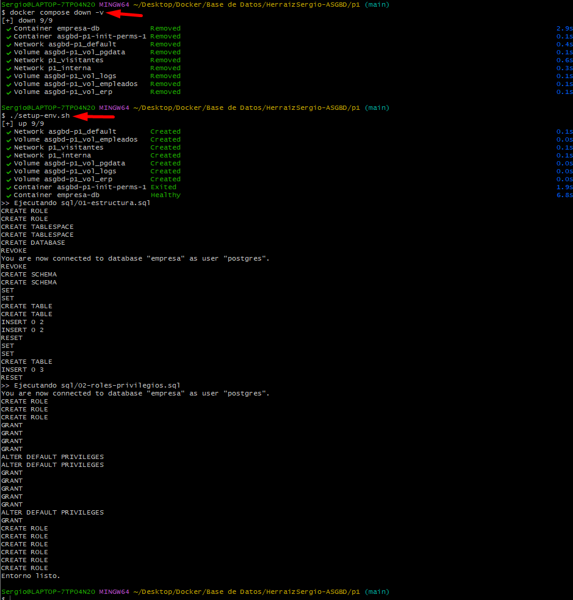

### 1.6 Evidencia: versión, puertos, memoria y redes

```bash
docker compose ps
docker port empresa-db
docker inspect empresa-db -f 'Memoria: {{.HostConfig.Memory}}  Swap total: {{.HostConfig.MemorySwap}}'
docker inspect empresa-db -f '{{range $k,$v := .NetworkSettings.Networks}}{{$k}}: {{$v.IPAddress}}{{"\n"}}{{end}}'
docker network inspect p1_interna p1_visitantes --format '{{.Name}}: {{range .IPAM.Config}}{{.Subnet}}{{end}}'
docker exec empresa-db psql -U postgres -c "SELECT version();"
```

```text
NAME         IMAGE           COMMAND                  SERVICE   CREATED         STATUS                    PORTS
empresa-db   postgres:16.4   "docker-entrypoint.s…"   db        2 minutes ago   Up 2 minutes (healthy)    5432/tcp

(docker port: sin salida, no hay puertos publicados)

Memoria: 2147483648  Swap total: 2147483648

p1_interna: 172.30.0.2
p1_visitantes: 172.31.0.2

p1_interna: 172.30.0.0/24
p1_visitantes: 172.31.0.0/24

PostgreSQL 16.4 (Debian 16.4-1.pgdg120+2) on x86_64-pc-linux-gnu, compiled by gcc (Debian 12.2.0-14) 12.2.0, 64-bit
```

| Comprobación | Resultado | Conclusión |
|---|---|---|
| `PORTS` | `5432/tcp` sin `->` | Expuesto solo dentro de las redes de Docker |
| `docker port` | Vacío | Ningún puerto publicado en el host |
| Memoria y swap | 2147483648 (= 2 GiB) ambos | Límite real, sin swap |
| IPs | `172.30.0.2` y `172.31.0.2` | Conectado a las dos redes |
| Subredes | `172.30.0.0/24` y `172.31.0.0/24` | Las del enunciado |

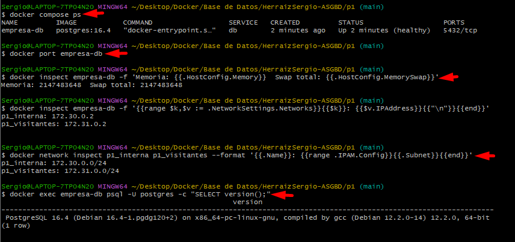

### 1.7 Evidencia: destruir el servidor y conservar los datos

```bash
docker exec empresa-db psql -U postgres -d empresa -c "SELECT count(*) FROM erp.clientes;"
docker compose down
docker compose up -d --wait
docker exec empresa-db psql -U postgres -d empresa -c "SELECT count(*) FROM erp.clientes;"
```

```text
 count
-------
     2

[+] down 5/5
 ✔ Container empresa-db            Removed
 ✔ Container asgbd-p1-init-perms-1 Removed
 ✔ Network p1_visitantes           Removed
 ✔ Network asgbd-p1_default        Removed
 ✔ Network p1_interna              Removed

[+] up 5/5
 ✔ Network asgbd-p1_default        Created
 ✔ Network p1_interna              Created
 ✔ Network p1_visitantes           Created
 ✔ Container asgbd-p1-init-perms-1 Exited
 ✔ Container empresa-db            Healthy

 count
-------
     2
```

`docker compose down` elimina contenedores y redes pero **no los volúmenes**. Al recrear el contenedor, PostgreSQL reutiliza los datos de `vol_pgdata`.

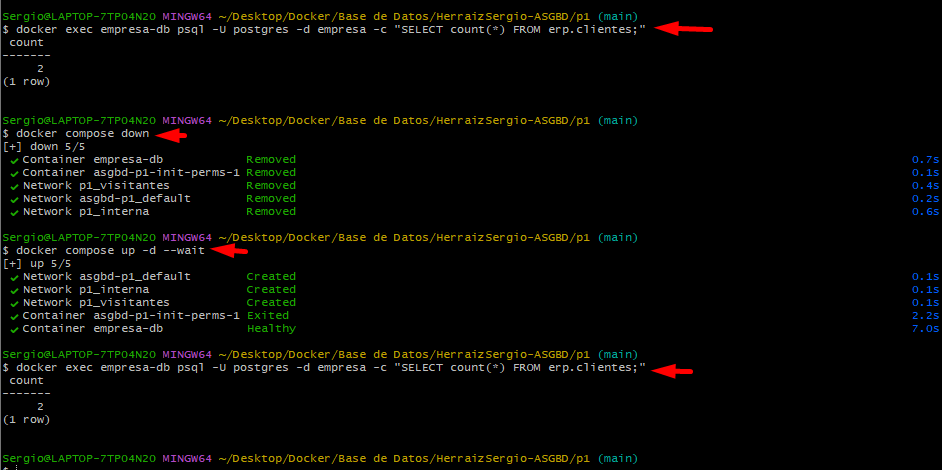

### 1.8 Parámetros de red y configuración general

Como el servidor arranca con `config_file` propio, PostgreSQL **no** lee el `postgresql.conf` del directorio de datos: todo lo relevante está en [`conf/postgresql.conf`](conf/postgresql.conf). El fichero `postgresql.auto.conf` (el que escribe `ALTER SYSTEM`) sí se sigue leyendo y tiene prioridad, de ahí la limpieza del apartado 3.7.

| Parámetro | Valor | Motivo |
|---|---|---|
| `listen_addresses` | `'*'` | Escucha en todas las interfaces del contenedor, es decir, en las dos redes. El control de acceso lo hace `pg_hba.conf`, no la interfaz |
| `port` | `5432` | Valor por defecto |
| `hba_file` | `/etc/postgresql/pg_hba.conf` | Usa el `pg_hba.conf` versionado en el repositorio |
| `max_connections` | `55` | Apartado 4 |
| `superuser_reserved_connections` | `3` | Apartado 4 |
| `shared_buffers`, `work_mem`, `maintenance_work_mem`, `wal_buffers`, `hash_mem_multiplier`, `effective_cache_size` | Véase apartado 3 | Reparto de memoria |
| `dynamic_shared_memory_type` | `posix` | Usa `/dev/shm`, dimensionado con `shm_size: 512m` |
| `logging_collector`, `log_*` | Véase apartado 6 | Trazabilidad |

---

<a id="apartado-2"></a>
## 2. Acceso restringido a la red interna

**Necesidad:** solo el ERP y el personal de la red interna pueden conectarse. Ningún cliente de la red de visitantes, aunque tenga ruta al servidor.

### 2.1 `pg_hba.conf`

```conf
# TYPE  DATABASE  USER  ADDRESS         METHOD
local   all       all                   trust
host    all       all   127.0.0.1/32    scram-sha-256
host    all       all   172.31.0.0/24   reject
host    all       all   172.30.0.0/24   scram-sha-256
host    all       all   0.0.0.0/0       reject
```

PostgreSQL lee las reglas de arriba abajo y aplica **la primera que coincide**. Por eso el orden importa.

| Línea | Función |
|---|---|
| `local ... trust` | Solo es alcanzable con `docker exec` dentro del contenedor. Lo necesita el arranque inicial de la imagen. Su riesgo se comenta en el apartado 11 |
| `127.0.0.1/32 scram` | Conexiones TCP locales desde el propio contenedor. El healthcheck usa `pg_isready`, que solo comprueba que el servidor responde y no depende de esta regla |
| `172.31.0.0/24 reject` | **Rechazo explícito** de la red de visitantes, que además deja constancia clara en el log |
| `172.30.0.0/24 scram` | Red interna: se permite con contraseña cifrada (SCRAM-SHA-256) |
| `0.0.0.0/0 reject` | Denegación por defecto de cualquier otro origen |

### 2.2 Reglas cargadas en el servidor

```bash
docker exec empresa-db psql -U postgres -c "SELECT line_number, type, address, auth_method FROM pg_hba_file_rules;"
```

```text
 line_number | type  |  address   |  auth_method
-------------+-------+------------+---------------
           3 | local |            | trust
           4 | host  | 127.0.0.1  | scram-sha-256
           5 | host  | 172.31.0.0 | reject
           6 | host  | 172.30.0.0 | scram-sha-256
           7 | host  | 0.0.0.0    | reject
(5 rows)
```

La columna `address` muestra la red sin máscara (la máscara está en la columna `netmask`, que esta consulta no incluye).

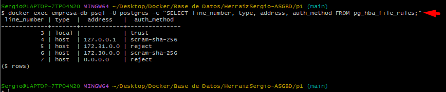

### 2.3 Cliente de la red interna: conecta

```bash
docker run --rm --network p1_interna -e PGPASSWORD="$INITIAL_USER_PASSWORD" \
  postgres:16.4 psql -h db -U analista1 -d empresa \
  -c "SELECT current_user, inet_client_addr(), inet_server_addr();"
```

```text
 current_user | inet_client_addr | inet_server_addr
--------------+------------------+------------------
 analista1    | 172.30.0.3       | 172.30.0.2
(1 row)
```

El cliente (`172.30.0.3`) está en la red interna y la conexión se acepta.

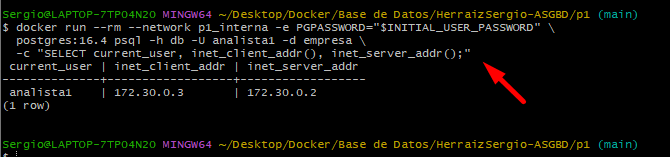

### 2.4 Cliente de la red de visitantes: rechazado por el SGBD

Primero se demuestra que **hay ruta de red**: el servidor responde.

```bash
docker run --rm --network p1_visitantes postgres:16.4 pg_isready -h db
```

```text
db:5432 - accepting connections
```

Después se intenta autenticar:

```bash
docker run --rm --network p1_visitantes -e PGPASSWORD="$INITIAL_USER_PASSWORD" \
  postgres:16.4 psql -h db -U analista1 -d empresa -c "SELECT 1;"
```

```text
psql: error: connection to server at "db" (172.31.0.2), port 5432 failed: FATAL:  pg_hba.conf rejects connection for host "172.31.0.3", user "analista1", database "empresa", no encryption
```

**Conclusión:** la red permite llegar al servidor (`accepting connections`), pero el mensaje procede de `pg_hba.conf`. El rechazo es una decisión del SGBD, no una ausencia de ruta.

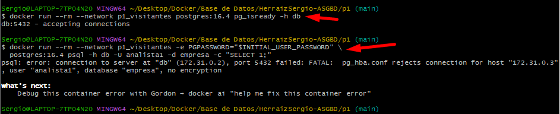

---

<a id="apartado-3"></a>
## 3. Memoria

**Necesidad:** aprovechar los 2 GB sin quedarse cortos ni pasarse. Si el servidor supera el límite del contenedor, Docker lo mata.

### 3.1 Parámetros elegidos

| Clase | Parámetro | Valor | Cuándo se reserva |
|---|---|---|---|
| Compartida | `shared_buffers` | 512 MB | Una vez, al arrancar (caché de datos). 25 % de 2 GB |
| Compartida | `wal_buffers` | 16 MB | Una vez, al arrancar |
| Por operación | `work_mem` | 4 MB | Por cada ordenación o hash, de cada sesión |
| Por operación | `hash_mem_multiplier` | 1.0 | Evita que las operaciones hash usen más que `work_mem` y hace el cálculo predecible |
| Mantenimiento | `maintenance_work_mem` | 32 MB | `VACUUM`, `CREATE INDEX` |
| Solo planificador | `effective_cache_size` | 1 GB | No reserva memoria: es una pista para el planificador |

### 3.2 Cálculo del peor caso

Sesiones de usuario posibles: 55 − 3 reservadas = **52**. Se supone un máximo de 3 nodos de ordenación o hash simultáneos por consulta.

| Concepto | Cálculo | MB |
|---|---|---|
| `shared_buffers` | fijo | 512 |
| Otras estructuras compartidas (WAL, locks...) | estimación | 64 |
| Mantenimiento | 32 MB × 4 (1 manual + 3 autovacuum) | 128 |
| Base por proceso backend | 55 × ~5 MB | 275 |
| `work_mem` de las sesiones | 52 sesiones × 3 nodos × 4 MB | 624 |
| `work_mem` de trabajadores paralelos | 8 trabajadores × 3 nodos × 4 MB | 96 |
| Sistema operativo y procesos internos | estimación | 128 |
| **Total** | | **1827** |
| **Margen** | 2048 − 1827 | **221 (≈ 11 %)** |

**Por qué influye el número de conexiones:** `work_mem` se multiplica por sesiones y por nodos. Con 200 conexiones el mismo cálculo daría 2400 MB solo de `work_mem`, y Docker mataría el contenedor. El valor de `max_connections` y el de `work_mem` se deciden a la vez.

**Trabajadores paralelos:** las consultas paralelas lanzan procesos adicionales que también usan `work_mem`. Se han contado con el máximo por defecto de PostgreSQL 16 (`max_parallel_workers = 8`, comprobable con `SHOW max_parallel_workers;`). La memoria compartida dinámica de esas consultas reside en `/dev/shm` y computa dentro del límite del contenedor; se considera incluida en la estimación de «otras estructuras compartidas».

Las cifras marcadas como «estimación» (64, 128, ~5 MB por backend) son aproximaciones prudentes, no mediciones.

### 3.3 Valores en uso

```bash
docker exec empresa-db psql -U postgres -c "SELECT name, setting, unit, context, pending_restart FROM pg_settings WHERE name IN ('shared_buffers','work_mem','maintenance_work_mem','max_connections','wal_buffers','hash_mem_multiplier','effective_cache_size');"
docker stats --no-stream empresa-db
```

```text
         name         | setting | unit |  context   | pending_restart
----------------------+---------+------+------------+-----------------
 effective_cache_size | 131072  | 8kB  | user       | f
 hash_mem_multiplier  | 1       |      | user       | f
 maintenance_work_mem | 32768   | kB   | user       | f
 max_connections      | 55      |      | postmaster | f
 shared_buffers       | 65536   | 8kB  | postmaster | f
 wal_buffers          | 2048    | 8kB  | postmaster | f
 work_mem             | 4096    | kB   | user       | f
(7 rows)

CONTAINER ID   NAME         CPU %   MEM USAGE / LIMIT   MEM %   NET I/O           BLOCK I/O    PIDS
2d9d2c4ebc70   empresa-db   6.47%   40.93MiB / 2GiB     2.00%   6.15kB / 3.09kB   0B / 578kB   7
```

### 3.4 Tabla de entrega

| Parámetro | Valor en `pg_settings` | Equivalencia | Cálculo que lo justifica | Contexto |
|---|---|---|---|---|
| `shared_buffers` | 65536 (8 kB) | 512 MB | 25 % de 2 GB | `postmaster` (reinicio) |
| `wal_buffers` | 2048 (8 kB) | 16 MB | Coincide con el valor automático de PostgreSQL (1/32 de `shared_buffers`, con tope de 16 MB) | `postmaster` (reinicio) |
| `work_mem` | 4096 kB | 4 MB | (52 + 8) × 3 × 4 MB = 720 MB | `user` (sin reinicio) |
| `maintenance_work_mem` | 32768 kB | 32 MB | 4 procesos × 32 MB = 128 MB | `user` (sin reinicio) |
| `hash_mem_multiplier` | 1 | 1.0 | Hace predecible el peor caso | `user` (sin reinicio) |
| `max_connections` | 55 | 55 | Véase apartado 4 | `postmaster` (reinicio) |
| `effective_cache_size` | 131072 (8 kB) | 1 GB | Pista al planificador, no reserva | `user` (sin reinicio) |

**Sobre `docker stats`:** en reposo el contenedor usa unos 41 MiB, muy por debajo de los 2 GiB. No contradice el cálculo: los 1827 MB son el **peor caso** (todas las sesiones al máximo a la vez), no el uso normal. `shared_buffers` se reserva como espacio de direcciones, pero el sistema operativo no asigna las páginas hasta que se tocan.

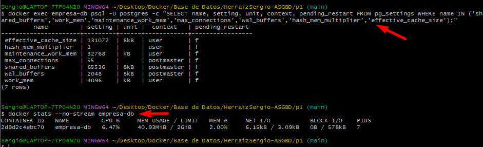

### 3.5 Parámetro que se cambia SIN reiniciar: `work_mem`

```bash
docker exec empresa-db psql -U postgres -c "SHOW work_mem;"
docker exec empresa-db psql -U postgres -c "ALTER SYSTEM SET work_mem='8MB';"
docker exec empresa-db psql -U postgres -c "SELECT pg_reload_conf();"
docker exec empresa-db psql -U postgres -c "SHOW work_mem;"
```

```text
 work_mem
----------
 4MB

ALTER SYSTEM

 pg_reload_conf
----------------
 t

 work_mem
----------
 8MB
```

El valor pasa de `4MB` a `8MB` con un simple `pg_reload_conf()`, sin reiniciar el servidor. Su contexto es `user`.

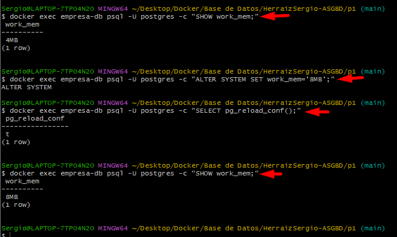

### 3.6 Parámetro que REQUIERE reinicio: `shared_buffers`

```bash
docker exec empresa-db psql -U postgres -c "ALTER SYSTEM SET shared_buffers='256MB';"
docker exec empresa-db psql -U postgres -c "SELECT pg_reload_conf();"
docker exec empresa-db psql -U postgres -c "SHOW shared_buffers;"
docker exec empresa-db psql -U postgres -c "SELECT name, setting, pending_restart FROM pg_settings WHERE name='shared_buffers';"
docker restart empresa-db
docker exec empresa-db psql -U postgres -c "SHOW shared_buffers;"
```

```text
ALTER SYSTEM

 pg_reload_conf
----------------
 t

 shared_buffers
----------------
 512MB

      name      | setting | pending_restart
----------------+---------+-----------------
 shared_buffers | 65536   | t

empresa-db

 shared_buffers
----------------
 256MB
```

Tras recargar, el valor en uso **sigue siendo 512MB** y `pending_restart = t` indica que hay un cambio pendiente. Solo cambia a `256MB` después de reiniciar el contenedor. Su contexto es `postmaster`.

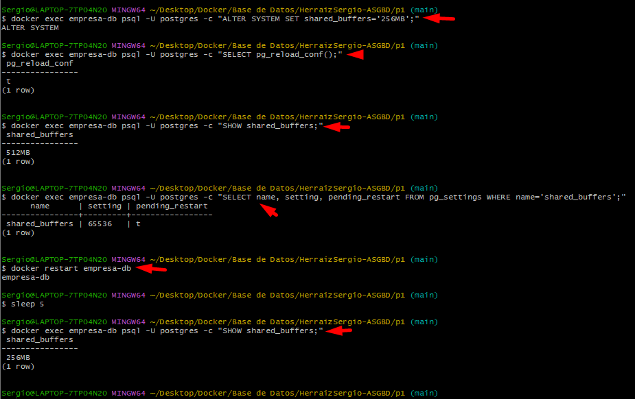

### 3.7 Limpieza: volver a los valores calculados

`ALTER SYSTEM` escribe en `postgresql.auto.conf`, dentro del volumen de datos, y ese fichero **tiene prioridad** sobre `postgresql.conf`. Si no se limpia, los valores de prueba se quedarían para siempre.

```bash
docker exec empresa-db psql -U postgres -c "ALTER SYSTEM RESET ALL;"
docker restart empresa-db
docker exec empresa-db psql -U postgres -c "SHOW work_mem;" -c "SHOW shared_buffers;"
```

```text
 work_mem
----------
 4MB

 shared_buffers
----------------
 512MB
```

La comprobación de que los valores vuelven a proceder de `postgresql.conf` está en el apartado 8.7.

---

<a id="apartado-4"></a>
## 4. Conexiones

**Necesidad:** admitir todas las conexiones simultáneas que puedan abrir el ERP y el personal, pero no más de las necesarias.

### 4.1 Cálculo

| Concepto | Cálculo | Conexiones |
|---|---|---|
| ERP | 3 instancias × 15 conexiones | 45 |
| Personal de RRHH | 2 personas | 2 |
| Analistas | 3 personas | 3 |
| **Subtotal simultáneo** | | **50** |
| Reservadas al superusuario | `superuser_reserved_connections` | 3 |
| Margen | holgura mínima | 2 |
| **`max_connections`** | 50 + 3 + 2 | **55** |

Para usuarios normales quedan 52 conexiones (55 − 3), que cubren las 50 necesarias.

**Por qué no más:** cada conexión extra cuesta memoria (~5 MB de base más `work_mem` por operación), y eso entra en el cálculo de los 2 GB.

**Por qué reservar 3:** permiten que el DBA entre aunque el servidor esté lleno de sesiones, que es justo cuando hace falta diagnosticar.

### 4.2 Valores en uso

```bash
docker exec empresa-db psql -U postgres -c "SHOW max_connections;" -c "SHOW superuser_reserved_connections;"
```

```text
 max_connections
-----------------
 55

 superuser_reserved_connections
--------------------------------
 3
```

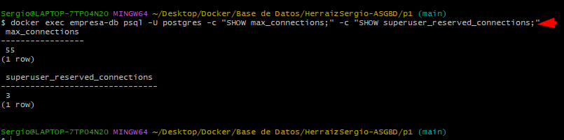

### 4.3 Superar el límite

Se lanzan 60 sesiones simultáneas de `analista1`:

```bash
docker run --rm --network p1_interna -e PGPASSWORD="$INITIAL_USER_PASSWORD" \
  postgres:16.4 bash -c '
for i in $(seq 1 60); do
  psql -h db -U analista1 -d empresa -c "select pg_sleep(20)" >/dev/null 2>>/tmp/err &
done
sleep 8
echo "--- Errores recibidos:"
sort /tmp/err | uniq -c
wait'
```

```text
--- Errores recibidos:
      9 psql: error: connection to server at "db" (172.30.0.2), port 5432 failed: FATAL:  remaining connection slots are reserved for roles with the SUPERUSER attribute
```

| Dato | Valor |
|---|---|
| Intentos simultáneos | 60 |
| Rechazados | 9 |
| Admitidos | 51 |
| Error | `remaining connection slots are reserved for roles with the SUPERUSER attribute` |

**Interpretación:** PostgreSQL admite a un usuario normal solo mientras queden libres más ranuras que las reservadas. Con `max_connections = 55` y 3 reservadas, un usuario normal puede entrar hasta que haya 52 ranuras ocupadas; a partir de ahí el servidor responde con el error anterior y solo deja pasar a superusuarios.

**Verificación con `pg_stat_activity`:** durante la prueba se consultó el número de sesiones abiertas:

```bash
docker exec empresa-db psql -U postgres -c "SELECT backend_type, count(*) FROM pg_stat_activity GROUP BY 1 ORDER BY 2 DESC;"
```

```text
         backend_type          | count
-------------------------------+-------
 client backend                |    52
 walwriter                     |     1
 autovacuum launcher           |     1
 logical replication launcher  |     1
 background writer             |     1
 checkpointer                  |     1
(6 rows)
```

Había 52 sesiones de tipo `client backend`. Una de ellas es la propia consulta del DBA (superusuario), así que quedaban 51 sesiones de prueba, lo que coincide con 60 intentos − 9 rechazos. Con 52 ranuras ocupadas el servidor ya solo tiene libres las 3 reservadas, y por eso rechaza a las demás.

**Limitación:** la consulta anterior se ejecutó en una ejecución de la prueba en la que ya había una sesión de DBA, que ocupa una ranura. No se ha repetido la prueba sin ninguna sesión adicional, donde cabría esperar 52 admitidas y 8 rechazadas. Lo relevante para el requisito es que, al superar el límite, el servidor rechaza la conexión con el error esperado.

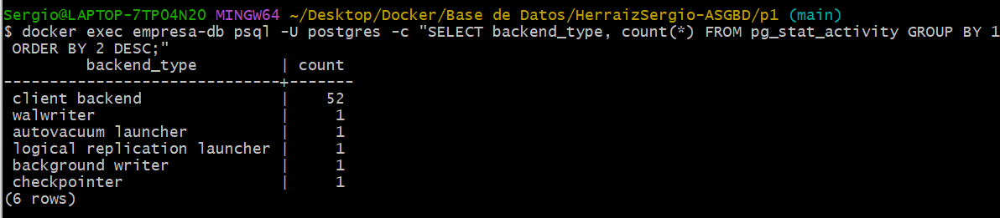

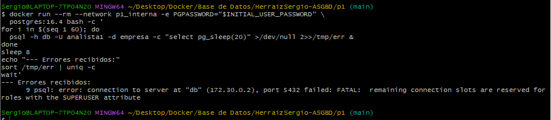

---

<a id="apartado-5"></a>
## 5. Almacenamiento

**Necesidad:** al menos dos tablespaces (ERP y empleados) en volúmenes distintos, con datos que sobreviven a un reinicio.

### 5.1 Diseño

| Tablespace | Ruta en el contenedor | Volumen Docker | Propietario | Contenido |
|---|---|---|---|---|
| `tbs_erp` | `/tablespaces/erp` | `asgbd-p1_vol_erp` | `erp_owner` | Esquema `erp` |
| `tbs_empleados` | `/tablespaces/empleados` | `asgbd-p1_vol_empleados` | `emp_owner` | Esquema `empleados` |

### 5.2 Scripts SQL de estructura (`sql/01-estructura.sql`)

```sql
-- Propietarios de los datos: nadie se conecta con ellos (NOLOGIN)
CREATE ROLE erp_owner NOLOGIN;
CREATE ROLE emp_owner NOLOGIN;

-- Tablespaces en volúmenes distintos
CREATE TABLESPACE tbs_erp       OWNER erp_owner LOCATION '/tablespaces/erp';
CREATE TABLESPACE tbs_empleados OWNER emp_owner LOCATION '/tablespaces/empleados';

CREATE DATABASE empresa;
REVOKE ALL ON DATABASE empresa FROM PUBLIC;

\connect empresa
REVOKE ALL ON SCHEMA public FROM PUBLIC;

CREATE SCHEMA erp       AUTHORIZATION erp_owner;
CREATE SCHEMA empleados AUTHORIZATION emp_owner;

-- Tablas e índices del ERP, en su tablespace
SET default_tablespace = tbs_erp;
SET ROLE erp_owner;
CREATE TABLE erp.clientes (id serial PRIMARY KEY, nombre text NOT NULL);
CREATE TABLE erp.pedidos  (id serial PRIMARY KEY,
                           cliente_id int REFERENCES erp.clientes(id),
                           importe numeric(10,2));
INSERT INTO erp.clientes(nombre) VALUES ('ACME'), ('Globex');
INSERT INTO erp.pedidos(cliente_id, importe) VALUES (1, 100.50), (2, 250.00);
RESET ROLE;

-- Tablas e índices de empleados, en el suyo
SET default_tablespace = tbs_empleados;
SET ROLE emp_owner;
CREATE TABLE empleados.empleados (id serial PRIMARY KEY, nombre text NOT NULL,
                                  departamento text, salario numeric(10,2));
INSERT INTO empleados.empleados(nombre, departamento, salario)
VALUES ('Ana','RRHH',2500), ('Luis','IT',3100), ('Marta','Ventas',2800);
RESET ROLE;
```

**Decisiones:**

- Los propietarios son `NOLOGIN`: nadie ni ninguna aplicación se conecta con ellos.
- `SET default_tablespace` antes de crear las tablas asegura que **también los índices** de las claves primarias queden en el tablespace correcto.
- `REVOKE ALL ... FROM PUBLIC` cierra los permisos que PostgreSQL concede por defecto a cualquiera.
- La columna `salario` ya existe en la tabla de empleados, como pedía el enunciado.

### 5.3 Dónde está cada espacio (diccionario de datos)

```bash
docker exec empresa-db psql -U postgres -c "SELECT spcname, pg_tablespace_location(oid) AS ubicacion, pg_get_userbyid(spcowner) AS propietario FROM pg_tablespace;"
```

```text
    spcname    |       ubicacion        | propietario
---------------+------------------------+-------------
 pg_default    |                        | postgres
 pg_global     |                        | postgres
 tbs_erp       | /tablespaces/erp       | erp_owner
 tbs_empleados | /tablespaces/empleados | emp_owner
(4 rows)
```

`pg_default` y `pg_global` viven dentro del directorio de datos, por eso su ubicación aparece vacía.

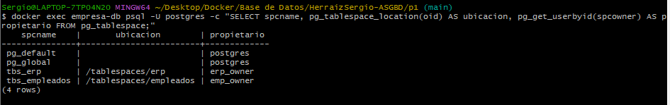

### 5.4 Qué objetos hay en cada espacio

```bash
docker exec empresa-db psql -U postgres -d empresa -c "SELECT schemaname, tablename, tablespace FROM pg_tables WHERE schemaname IN ('erp','empleados');"
docker exec empresa-db psql -U postgres -d empresa -c "SELECT schemaname, indexname, tablespace FROM pg_indexes WHERE schemaname IN ('erp','empleados');"
```

```text
 schemaname | tablename |  tablespace
------------+-----------+---------------
 empleados  | empleados | tbs_empleados
 erp        | clientes  | tbs_erp
 erp        | pedidos   | tbs_erp

 schemaname |   indexname    |  tablespace
------------+----------------+---------------
 erp        | clientes_pkey  | tbs_erp
 erp        | pedidos_pkey   | tbs_erp
 empleados  | empleados_pkey | tbs_empleados
```

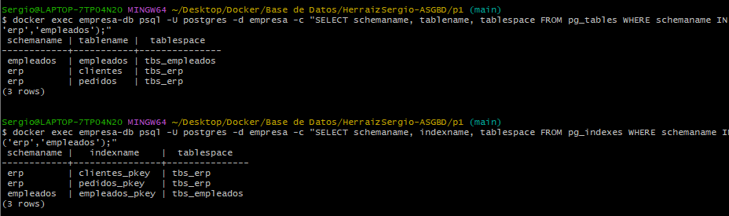

### 5.5 Del catálogo al fichero físico

```bash
docker exec empresa-db psql -U postgres -d empresa -c "SELECT pg_relation_filepath('erp.clientes') AS erp, pg_relation_filepath('empleados.empleados') AS empleados;"
docker exec empresa-db sh -c 'ls -R /tablespaces/erp | head -10'
docker exec empresa-db sh -c 'ls -R /tablespaces/empleados | head -10'
docker inspect empresa-db -f '{{range .Mounts}}{{.Name}} -> {{.Destination}}{{"\n"}}{{end}}'
```

```text
                     erp                     |                  empleados
---------------------------------------------+---------------------------------------------
 pg_tblspc/16386/PG_16_202307071/16388/16392 | pg_tblspc/16387/PG_16_202307071/16388/16413

/tablespaces/erp:
PG_16_202307071

/tablespaces/erp/PG_16_202307071:
16388

/tablespaces/erp/PG_16_202307071/16388:
16392
16396
16397

/tablespaces/empleados:
PG_16_202307071

/tablespaces/empleados/PG_16_202307071:
16388

/tablespaces/empleados/PG_16_202307071/16388:
16413
16417
16418

 -> /etc/postgresql
asgbd-p1_vol_empleados -> /tablespaces/empleados
asgbd-p1_vol_erp -> /tablespaces/erp
asgbd-p1_vol_logs -> /var/log/postgresql
asgbd-p1_vol_pgdata -> /var/lib/postgresql/data
```

**Cómo leerlo:**

| Elemento | Significado |
|---|---|
| `16386` / `16387` | OID del tablespace (`pg_tblspc/` es un enlace simbólico hacia `/tablespaces/...`) |
| `PG_16_202307071` | Directorio que PostgreSQL crea para la versión 16 |
| `16388` | OID de la base de datos `empresa` |
| `16392` / `16413` | Fichero de la tabla `clientes` / `empleados` |
| Montaje sin nombre (`/etc/postgresql`) | *Bind mount* de `./conf`, no es un volumen |

Cada tablespace está en un volumen distinto, lo que cumple el requisito.

**Nota:** el comando `ls` está limitado a 10 líneas con `head -10`, y la salida se corta exactamente en esa línea, por lo que **no se listan todos los ficheros** de cada tablespace (por ejemplo, los de las demás tablas e índices).

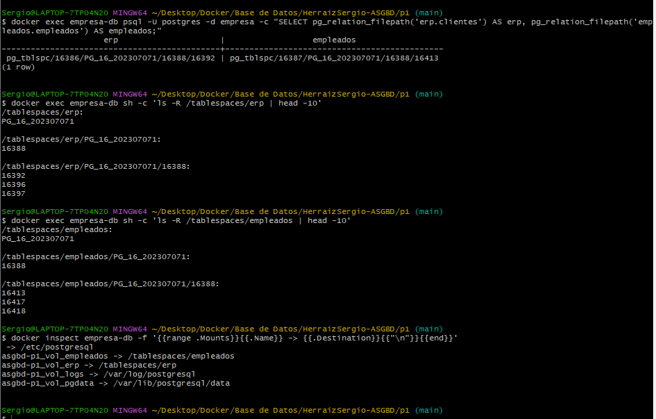

### 5.6 Persistencia tras reiniciar el contenedor

```bash
docker exec empresa-db psql -U postgres -d empresa -c "SELECT (SELECT count(*) FROM erp.clientes) AS erp, (SELECT count(*) FROM empleados.empleados) AS empleados;"
docker restart empresa-db
sleep 5
docker exec empresa-db psql -U postgres -d empresa -c "SELECT (SELECT count(*) FROM erp.clientes) AS erp, (SELECT count(*) FROM empleados.empleados) AS empleados;"
```

```text
 erp | empleados
-----+-----------
   2 |         3

empresa-db

 erp | empleados
-----+-----------
   2 |         3
```

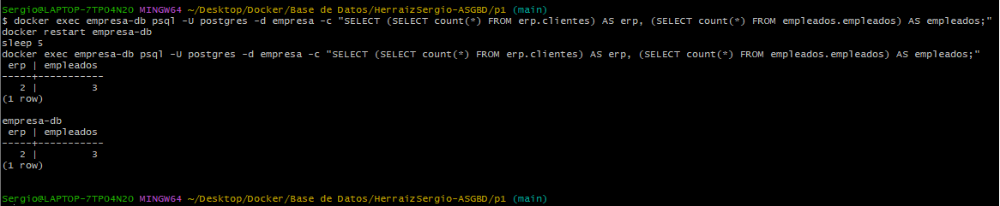

---

<a id="apartado-6"></a>
## 6. Trazabilidad

**Necesidad:** si alguien intenta conectarse sin permiso debe quedar constancia, aunque el contenedor se destruya.

### 6.1 Configuración

En `postgresql.conf`:

```conf
logging_collector = on
log_directory = '/var/log/postgresql'
log_filename = 'postgresql-%Y-%m-%d.log'
log_connections = on
log_disconnections = on
log_line_prefix = '%m [%p] %q%u@%d (%h) '
```

| Parámetro | Motivo |
|---|---|
| `logging_collector = on` | Escribe los registros en fichero en lugar de en `docker logs` |
| `log_directory` | Apunta al volumen persistente `vol_logs` |
| `log_filename` | Un fichero por día |
| `log_connections` / `log_disconnections` | Registra cada intento de conexión y su fin |
| `log_line_prefix` | Incluye fecha, PID, usuario, base de datos y **IP de origen** (`%h`) |

Al activar el colector, `docker logs` deja de mostrar la actividad del servidor (solo un aviso de redirección). Es lo esperado.

### 6.2 Los rechazos aparecen en el fichero

```bash
docker exec empresa-db sh -c 'grep -h "rejects" /var/log/postgresql/*.log'
```

```text
2026-11-02 07:42:00.837 GMT [537] root@root (172.31.0.3) FATAL:  pg_hba.conf rejects connection for host "172.31.0.3", user "root", database "root", no encryption
2026-11-02 07:42:12.013 GMT [587] analista1@empresa (172.31.0.3) FATAL:  pg_hba.conf rejects connection for host "172.31.0.3", user "analista1", database "empresa", no encryption
2026-11-02 07:54:19.268 GMT [163] analista1@empresa (172.31.0.3) FATAL:  pg_hba.conf rejects connection for host "172.31.0.3", user "analista1", database "empresa", no encryption
```

- La primera línea corresponde al `pg_isready` del apartado 2, que se conecta sin usuario explícito (usa el del sistema, `root`). Queda registrado incluso un simple sondeo.
- La segunda es el intento de `analista1` desde la red de visitantes del apartado 2.4.
- La tercera es un intento posterior, generado para comprobar que el registro sigue recibiendo líneas nuevas. Su PID (163) es menor que el de las anteriores, lo que indica que el servidor se había reiniciado entre medias.

### 6.3 El registro sobrevive a la destrucción del contenedor

```bash
docker exec empresa-db sh -c 'grep -h "rejects" /var/log/postgresql/*.log'
docker compose down
docker compose up -d --wait
docker exec empresa-db sh -c 'grep -h "rejects" /var/log/postgresql/*.log'
```

Tras destruir y recrear el contenedor, **las mismas tres líneas siguen apareciendo**, porque el fichero vive en el volumen `vol_logs`.

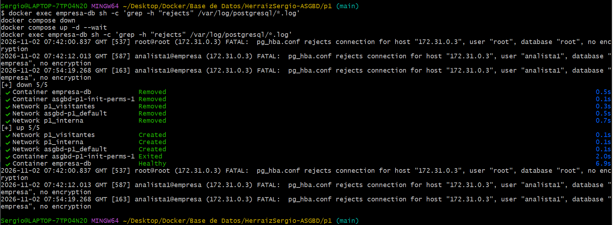

---

<a id="apartado-7"></a>
## 7. Cuenta de la aplicación

**Necesidad:** el ERP accede solo a sus datos, un error o ataque en la aplicación no puede modificar la estructura, y la aplicación no puede quedarse sin acceso de forma inesperada.

### 7.1 Diseño

| Elemento | Configuración | Motivo |
|---|---|---|
| `erp_owner` | `NOLOGIN`, propietario del esquema `erp` y sus tablas | Nadie se conecta con él |
| `erp_rw` | Rol de grupo con `SELECT, INSERT, UPDATE, DELETE` y uso de secuencias | Mínimo privilegio: sin `CREATE`, sin `DROP` |
| `erp_app` | `LOGIN`, miembro de `erp_rw`, `CONNECTION LIMIT 45`, `VALID UNTIL 'infinity'` | Cuenta de conexión distinta del propietario |
| `ALTER DEFAULT PRIVILEGES` | Sobre `erp_owner` en el esquema `erp` | Las tablas futuras del ERP heredan los privilegios |

Fragmento de `sql/02-roles-privilegios.sql`:

```sql
CREATE ROLE erp_rw NOLOGIN;
GRANT CONNECT ON DATABASE empresa TO erp_rw;

GRANT USAGE ON SCHEMA erp TO erp_rw;
GRANT SELECT, INSERT, UPDATE, DELETE ON ALL TABLES IN SCHEMA erp TO erp_rw;
GRANT USAGE, SELECT ON ALL SEQUENCES IN SCHEMA erp TO erp_rw;
ALTER DEFAULT PRIVILEGES FOR ROLE erp_owner IN SCHEMA erp
  GRANT SELECT, INSERT, UPDATE, DELETE ON TABLES TO erp_rw;
ALTER DEFAULT PRIVILEGES FOR ROLE erp_owner IN SCHEMA erp
  GRANT USAGE, SELECT ON SEQUENCES TO erp_rw;

CREATE ROLE erp_app LOGIN PASSWORD :'erp_pwd'
  CONNECTION LIMIT 45 VALID UNTIL 'infinity' IN ROLE erp_rw;
```

**Por qué 45:** 3 instancias × 15 conexiones. Un límite exacto impide que un fallo del ERP consuma las conexiones que necesita el personal.

### 7.2 Lo que SÍ puede hacer

```bash
ERP="docker run --rm --network p1_interna -e PGPASSWORD=$ERP_APP_PASSWORD postgres:16.4 psql -h db -U erp_app -d empresa"
$ERP -c "SELECT current_user;"
$ERP -c "INSERT INTO erp.clientes(nombre) VALUES ('Nuevo cliente');"
$ERP -c "SELECT * FROM erp.clientes;"
$ERP -c "UPDATE erp.clientes SET nombre='Nuevo cliente SL' WHERE nombre='Nuevo cliente';"
```

```text
 current_user
--------------
 erp_app

INSERT 0 1

 id |    nombre
----+---------------
  1 | ACME
  2 | Globex
  3 | Nuevo cliente

UPDATE 1
```

### 7.3 Lo que NO puede hacer

```bash
$ERP -c "CREATE TABLE erp.prueba(x int);"
$ERP -c "DROP TABLE erp.pedidos;"
$ERP -c "ALTER TABLE erp.clientes ADD COLUMN x int;"
$ERP -c "SELECT * FROM empleados.empleados;"
```

```text
ERROR:  permission denied for schema erp
ERROR:  must be owner of table pedidos
ERROR:  must be owner of table clientes
ERROR:  permission denied for schema empleados
```

| Intento | Error | Razón |
|---|---|---|
| `CREATE TABLE` | `permission denied for schema erp` | `erp_rw` no tiene `CREATE` sobre el esquema |
| `DROP TABLE` | `must be owner of table` | Solo el propietario puede borrar, y `erp_app` no lo es |
| `ALTER TABLE` | `must be owner of table` | Ídem |
| Leer empleados | `permission denied for schema empleados` | El ERP solo accede a sus datos |

**Nota:** la captura recoge el `SELECT current_user`, el `INSERT`, el `CREATE`, el `DROP` y la lectura de `empleados`. Las líneas `SELECT * FROM erp.clientes`, `UPDATE` y `ALTER TABLE` se ejecutaron en una sesión de pruebas anterior con el mismo resultado que muestran los bloques de texto.

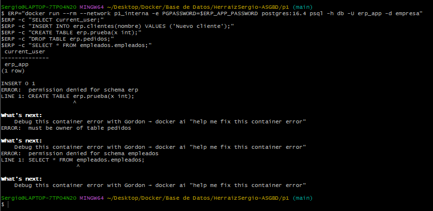

### 7.4 Atributos de las cuentas

```bash
docker exec empresa-db psql -U postgres -c "SELECT rolname, rolcanlogin, rolconnlimit, rolvaliduntil FROM pg_roles WHERE rolname IN ('erp_owner','emp_owner','erp_app');"
docker exec empresa-db psql -U postgres -c "SELECT r.rolname AS rol, m.rolname AS miembro_de FROM pg_auth_members a JOIN pg_roles r ON r.oid=a.member JOIN pg_roles m ON m.oid=a.roleid WHERE r.rolname='erp_app';"
```

```text
  rolname  | rolcanlogin | rolconnlimit | rolvaliduntil
-----------+-------------+--------------+---------------
 erp_owner | f           |           -1 |
 emp_owner | f           |           -1 |
 erp_app   | t           |           45 | infinity

   rol   | miembro_de
---------+------------
 erp_app | erp_rw
```

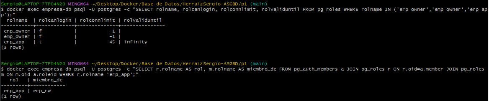

### 7.5 Superar el límite de la cuenta

```bash
docker run --rm --network p1_interna -e PGPASSWORD="$ERP_APP_PASSWORD" \
  postgres:16.4 bash -c '
for i in $(seq 1 50); do
  psql -h db -U erp_app -d empresa -c "select pg_sleep(20)" >/dev/null 2>>/tmp/err &
done
sleep 8
echo "--- Errores recibidos:"
sort /tmp/err | uniq -c
wait'
```

```text
--- Errores recibidos:
      5 psql: error: connection to server at "db" (172.30.0.2), port 5432 failed: FATAL:  too many connections for role "erp_app"
```

De 50 intentos, 45 entran y **5 son rechazados**, justo el exceso sobre el límite. El mensaje (`for role "erp_app"`) es distinto al del apartado 4 porque aquí actúa el límite **de la cuenta**, que se alcanza antes que el global.

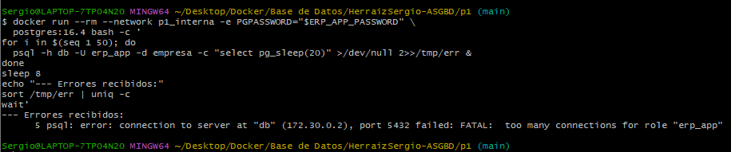

Después se limpia el dato de prueba:

```bash
docker exec empresa-db psql -U postgres -d empresa -c "DELETE FROM erp.clientes WHERE nombre LIKE 'Nuevo cliente%';"
```

---

<a id="apartado-8"></a>
## 8. Acceso del personal

**Necesidad:** cada persona tiene su cuenta, y dar de alta o de baja a un analista no debe obligar a revisar privilegios uno a uno.

### 8.1 Diseño

| Elemento | Configuración |
|---|---|
| `rol_rrhh` | Rol de grupo (`NOLOGIN`): `SELECT, INSERT, UPDATE, DELETE` sobre el esquema `empleados` |
| `rol_analista` | Rol de grupo (`NOLOGIN`): `SELECT` sobre el esquema `erp` y `SELECT (id, nombre, departamento)` sobre `empleados.empleados` |
| `rrhh1`, `rrhh2` | Cuentas personales, miembros de `rol_rrhh` |
| `analista1`, `analista2`, `analista3` | Cuentas personales, miembros de `rol_analista` |
| Caducidad | `VALID UNTIL` a 90 días desde el alta |
| Privilegio por columna | La columna `salario` no se concede al rol de analistas |

```sql
GRANT USAGE ON SCHEMA erp, empleados TO rol_analista;
GRANT SELECT ON ALL TABLES IN SCHEMA erp TO rol_analista;
GRANT SELECT (id, nombre, departamento) ON empleados.empleados TO rol_analista;

SELECT format('CREATE ROLE %I LOGIN PASSWORD %L VALID UNTIL %L IN ROLE rol_analista',
              u, :'user_pwd', CURRENT_DATE + 90)
FROM unnest(ARRAY['analista1','analista2','analista3']) AS u \gexec
```

**Sobre la caducidad:** PostgreSQL **no obliga** a cambiar la contraseña. `VALID UNTIL` solo impide iniciar sesión pasada esa fecha. Procedimiento de renovación, que debe ejecutar el DBA cada vez que una persona cambia su contraseña:

```sql
ALTER ROLE analista1 PASSWORD 'nueva_contraseña' VALID UNTIL '2027-04-30';
```

**Sobre las contraseñas iniciales:** el script crea las cinco cuentas con la misma contraseña inicial (`INITIAL_USER_PASSWORD`). Es una contraseña **temporal** para el alta: cada persona debe cambiarla en su primer acceso con `\password` en `psql`. Se reconoce como limitación en el apartado 11.

### 8.2 Un analista: consulta empleados pero no el salario

```bash
AN="docker run --rm --network p1_interna -e PGPASSWORD=$INITIAL_USER_PASSWORD postgres:16.4 psql -h db -d empresa"
$AN -U analista1 -c "SELECT id, nombre, departamento FROM empleados.empleados;"
$AN -U analista1 -c "SELECT salario FROM empleados.empleados;"
$AN -U analista1 -c "SELECT * FROM empleados.empleados;"
$AN -U analista1 -c "SELECT * FROM erp.pedidos;"
$AN -U analista1 -c "UPDATE empleados.empleados SET departamento='X' WHERE id=1;"
```

```text
 id | nombre | departamento
----+--------+--------------
  1 | Ana    | RRHH
  2 | Luis   | IT
  3 | Marta  | Ventas

ERROR:  permission denied for table empleados
ERROR:  permission denied for table empleados

 id | cliente_id | importe
----+------------+---------
  1 |          1 |  100.50
  2 |          2 |  250.00

ERROR:  permission denied for table empleados
```

`SELECT *` también falla porque incluye la columna `salario`: PostgreSQL exige privilegio sobre **todas** las columnas referenciadas. Los analistas deben nombrar las columnas.

**Nota:** la captura recoge las tres primeras consultas del bloque (lectura de columnas permitidas, `SELECT salario` rechazado y lectura del ERP). El `SELECT *` y el `UPDATE` se ejecutaron en una sesión de pruebas anterior con el resultado que se muestra.

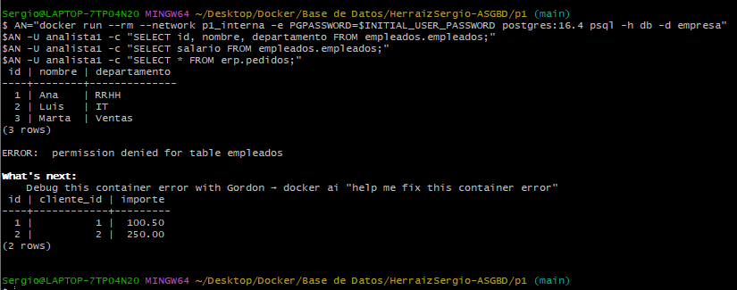

### 8.3 Personal de RRHH

```bash
$AN -U rrhh1 -c "SELECT * FROM empleados.empleados;"
$AN -U rrhh1 -c "UPDATE empleados.empleados SET salario=2600 WHERE id=1;"
$AN -U rrhh1 -c "SELECT * FROM erp.pedidos;"
$AN -U rrhh1 -c "UPDATE empleados.empleados SET salario=2500 WHERE id=1;"
```

```text
 id | nombre | departamento | salario
----+--------+--------------+---------
  1 | Ana    | RRHH         | 2500.00
  2 | Luis   | IT           | 3100.00
  3 | Marta  | Ventas       | 2800.00

UPDATE 1
ERROR:  permission denied for schema erp
UPDATE 1
```

RRHH ve y modifica salarios, pero no tiene acceso al ERP. La última sentencia restaura el valor original.

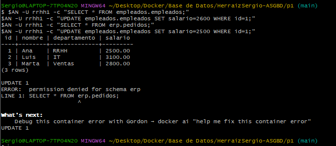

### 8.4 Alta de un analista nuevo: solo asignar el rol

```bash
docker exec empresa-db psql -U postgres -c "CREATE ROLE analista4 LOGIN PASSWORD '$INITIAL_USER_PASSWORD' VALID UNTIL '$(date -d '+90 days' +%F)';"
docker exec empresa-db psql -U postgres -c "GRANT rol_analista TO analista4;"
$AN -U analista4 -c "SELECT count(*) FROM erp.pedidos;"
$AN -U analista4 -c "SELECT id, nombre FROM empleados.empleados;"
$AN -U analista4 -c "SELECT salario FROM empleados.empleados;"
```

```text
CREATE ROLE
GRANT ROLE

 count
-------
     2

 id | nombre
----+--------
  2 | Luis
  3 | Marta
  1 | Ana

ERROR:  permission denied for table empleados
```

Con un único `GRANT rol_analista` la persona nueva puede hacer las mismas consultas que el resto, **sin ningún privilegio individual**, y el salario le es rechazado igual.

**Nota:** la captura de este apartado y la del siguiente es la misma y no incluye la consulta `SELECT id, nombre`, que se ejecutó en una sesión de pruebas anterior con el resultado mostrado.

### 8.5 Baja: retirar el rol

```bash
docker exec empresa-db psql -U postgres -c "REVOKE rol_analista FROM analista4;"
$AN -U analista4 -c "SELECT count(*) FROM erp.pedidos;"
```

```text
REVOKE ROLE

psql: error: connection to server at "db" (172.30.0.2), port 5432 failed: FATAL:  permission denied for database "empresa"
DETAIL:  User does not have CONNECT privilege.
```

Al retirar el rol, la persona pierde **todos** los privilegios, incluso el de conectarse. Esto se debe a que se hizo `REVOKE ALL ON DATABASE empresa FROM PUBLIC` y el `CONNECT` se concedió únicamente a los roles de grupo. Es un comportamiento deseable en una baja.

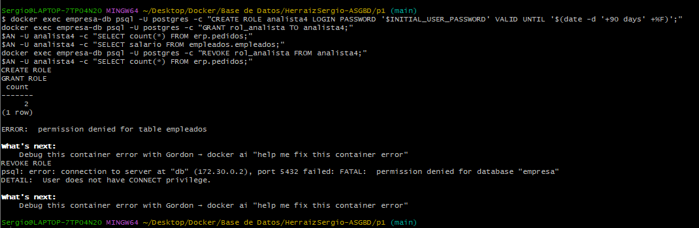

Limpieza:

```bash
docker exec empresa-db psql -U postgres -c "DROP ROLE analista4;"
```

### 8.6 Evidencia desde el diccionario de datos

```bash
docker exec empresa-db psql -U postgres -c "SELECT r.rolname AS persona, m.rolname AS rol, r.rolvaliduntil FROM pg_auth_members a JOIN pg_roles r ON r.oid=a.member JOIN pg_roles m ON m.oid=a.roleid WHERE r.rolname NOT LIKE 'pg_%' AND r.rolname <> 'erp_app' ORDER BY 2,1;"
docker exec empresa-db psql -U postgres -d empresa -c "SELECT grantee, table_name, column_name, privilege_type FROM information_schema.column_privileges WHERE grantee='rol_analista' AND table_schema='empleados' ORDER BY column_name;"
```

```text
  persona  |     rol      |     rolvaliduntil
-----------+--------------+------------------------
 analista1 | rol_analista | 2027-01-31 00:00:00+00
 analista2 | rol_analista | 2027-01-31 00:00:00+00
 analista3 | rol_analista | 2027-01-31 00:00:00+00
 rrhh1     | rol_rrhh     | 2027-01-31 00:00:00+00
 rrhh2     | rol_rrhh     | 2027-01-31 00:00:00+00
(5 rows)

   grantee    | table_name | column_name  | privilege_type
--------------+------------+--------------+----------------
 rol_analista | empleados  | departamento | SELECT
 rol_analista | empleados  | id           | SELECT
 rol_analista | empleados  | nombre       | SELECT
(3 rows)
```

La fecha de caducidad (31 de enero de 2027) es 90 días posterior al alta (2 de noviembre de 2026). La segunda consulta demuestra, desde el diccionario de datos, que `rol_analista` tiene `SELECT` sobre `id`, `nombre` y `departamento`, y **no** sobre `salario`.

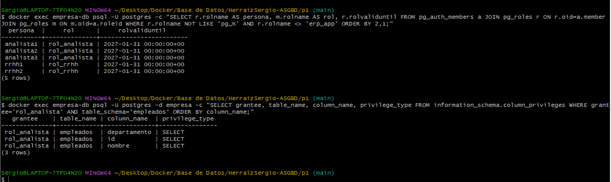

### 8.7 Verificación de limpieza del entorno

Tras las pruebas que modifican el estado del servidor (apartados 3, 7 y 8), se comprueba que el entorno vuelve a su situación inicial.

**Parámetros de memoria restaurados:** los valores vuelven a proceder de `postgresql.conf` y no de `postgresql.auto.conf`.

```bash
docker exec empresa-db psql -U postgres -c "SELECT name, setting, sourcefile FROM pg_settings WHERE name IN ('work_mem','shared_buffers');"
```

```text
      name      | setting |           sourcefile
----------------+---------+--------------------------------
 shared_buffers | 65536   | /etc/postgresql/postgresql.conf
 work_mem       | 4096    | /etc/postgresql/postgresql.conf
(2 rows)
```

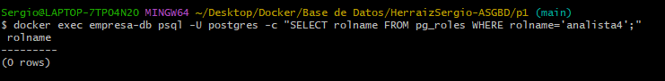

**Cuenta de prueba eliminada:**

```bash
docker exec empresa-db psql -U postgres -c "SELECT rolname FROM pg_roles WHERE rolname='analista4';"
```

```text
 rolname
---------
(0 rows)
```


**Datos del ERP sin restos de prueba:**

```bash
docker exec empresa-db psql -U postgres -d empresa -c "SELECT * FROM erp.clientes;"
```

```text
 id | nombre
----+--------
  1 | ACME
  2 | Globex
(2 rows)
```

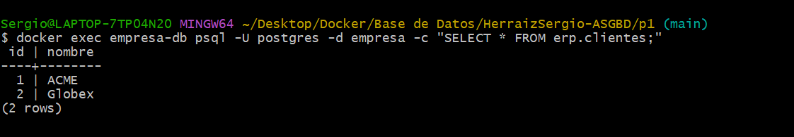

**Salario restaurado:**

```bash
docker exec empresa-db psql -U postgres -d empresa -c "SELECT id, salario FROM empleados.empleados WHERE id=1;"
```

```text
 id | salario
----+---------
  1 | 2500.00
(1 row)
```

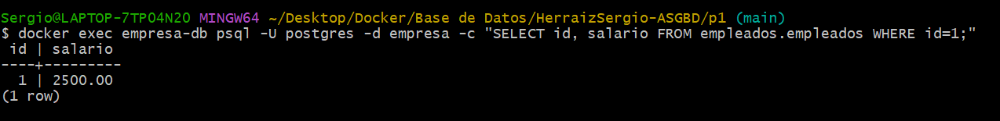

---

<a id="apartado-9"></a>
## 9. Ampliación: caída súbita (opcional)

**Necesidad:** el servidor puede caer en cualquier momento y no puede dejar los datos en un estado inconsistente.

### 9.1 Configuración

El servicio tiene `restart: unless-stopped` en el `docker-compose.yml`. Valores de partida:

```bash
docker inspect empresa-db -f 'Politica: {{.HostConfig.RestartPolicy.Name}}'
docker exec empresa-db psql -U postgres -c "SHOW synchronous_commit;" -c "SHOW fsync;" -c "SHOW wal_writer_delay;"
```

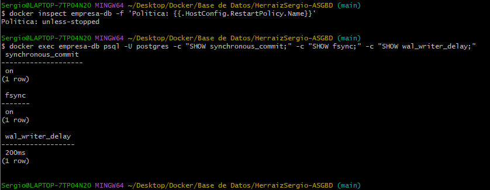

| Parámetro | Valor | Significado |
|---|---|---|
| `synchronous_commit` | `on` | El `COMMIT` no vuelve hasta que el WAL está en disco |
| `fsync` | `on` | PostgreSQL fuerza la escritura física a disco |
| `wal_writer_delay` | `200ms` | Cada cuánto escribe el WAL el proceso en segundo plano |

### 9.2 Caso A: lo confirmado se conserva y lo no confirmado se descarta

Se crea una tabla de laboratorio, se abre una transacción sin confirmar en segundo plano y, en otra sesión, se inserta una fila confirmada:

```bash
docker exec empresa-db psql -U postgres -d empresa -c "CREATE TABLE public.prueba_crash(id serial, nota text);"
( echo "BEGIN; INSERT INTO prueba_crash(nota) VALUES ('SIN commit');"; sleep 180 ) | docker exec -i empresa-db psql -U postgres -d empresa > /dev/null 2>&1 &
docker exec empresa-db psql -U postgres -d empresa -c "INSERT INTO prueba_crash(nota) VALUES ('CON commit');"
docker exec empresa-db psql -U postgres -d empresa -c "SELECT state, left(query,50) AS query FROM pg_stat_activity WHERE state='idle in transaction';" -c "SELECT * FROM prueba_crash;"
```

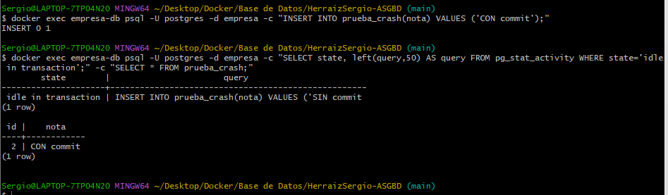

La sesión sin confirmar aparece como `idle in transaction`, y la tabla solo muestra `CON commit`: la otra fila existe únicamente dentro de esa sesión. `CON commit` tiene `id = 2` porque la fila sin confirmar consumió el valor 1 de la secuencia: las secuencias no se revierten con un rollback.

Se simula la caída enviando `SIGQUIT` al proceso principal (`kill -QUIT 1`), que provoca una parada inmediata sin cierre limpio, como un corte de luz a nivel de proceso:

```bash
docker exec empresa-db sh -c 'kill -QUIT 1'
sleep 15
docker ps --filter name=empresa-db
docker inspect empresa-db -f 'Reinicios: {{.RestartCount}}  Arranque: {{.State.StartedAt}}'
```

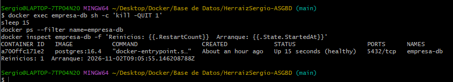

`Reinicios: 1` y estado `healthy`: Docker levantó el servidor aplicando la política de reinicio.

```bash
docker exec empresa-db psql -U postgres -d empresa -c "SELECT * FROM prueba_crash;"
docker exec empresa-db sh -c 'grep -h -E "immediate shutdown|not properly shut down|redo" /var/log/postgresql/*.log | tail -8'
```

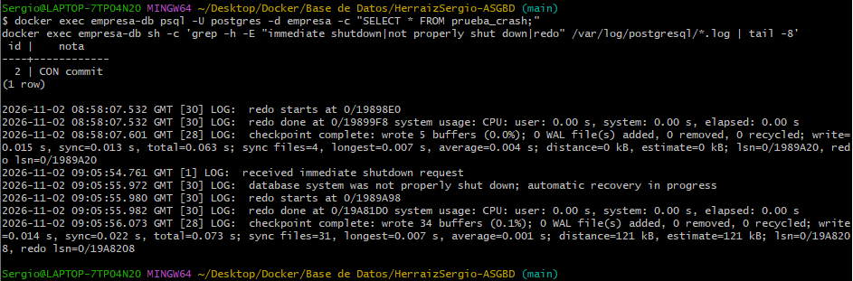

El log muestra `received immediate shutdown request` (09:05:54), después `database system was not properly shut down; automatic recovery in progress` y las líneas `redo starts` y `redo done` (09:05:55). Las tres primeras líneas de la captura (08:58) pertenecen a una recuperación anterior, de un intento previo. Solo sobrevive la fila `CON commit`.

**Por qué:** PostgreSQL escribe cada cambio en el WAL antes de confirmarlo. Al arrancar tras una caída, rehace (*redo*) lo confirmado y descarta lo que no tiene registro de `COMMIT`.

### 9.3 Caso B: perder una transacción confirmada

`synchronous_commit = off` mejora el rendimiento porque el `COMMIT` no espera a que el WAL llegue a disco. A cambio, una caída en ese intervalo pierde transacciones que el cliente creyó confirmadas. Para ampliar la ventana se sube `wal_writer_delay` a `10s` y se inserta en modo asíncrono, matando el servidor justo después:

```bash
docker exec empresa-db psql -U postgres -c "ALTER SYSTEM SET wal_writer_delay='10s';"
docker restart empresa-db
sleep 8
docker exec empresa-db psql -U postgres -c "SHOW wal_writer_delay;"
docker exec empresa-db psql -U postgres -d empresa -c "SET synchronous_commit=off" -c "INSERT INTO prueba_crash(nota) VALUES ('commit asincrono');" && docker exec empresa-db sh -c 'kill -QUIT 1'
```

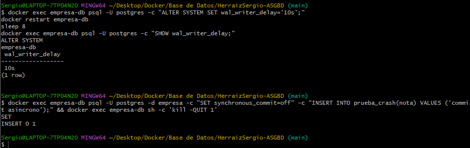

El cliente recibe `INSERT 0 1`. Tras la recuperación:

```bash
sleep 15
docker exec empresa-db psql -U postgres -d empresa -c "SELECT * FROM prueba_crash;"
```

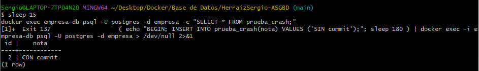

`commit asincrono` **no está en la tabla**. La base queda consistente y sin corrupción: solo se pierden las últimas transacciones. La captura muestra además `Exit 137` en el trabajo en segundo plano: la sesión sin confirmar del caso A murió con el servidor.

| Parámetro | Efecto | Riesgo |
|---|---|---|
| `synchronous_commit = off` | `COMMIT` inmediato, más rendimiento | Pérdida de hasta unas 3 veces `wal_writer_delay` de transacciones confirmadas |
| `fsync = off` | Aún más rápido | **Puede corromper la base** tras un fallo del sistema. No se ha probado |

`fsync = off` no se reproduce matando un contenedor, porque el kernel del host sigue vivo y conserva lo ya escrito.

### 9.4 Limpieza

`ALTER SYSTEM` escribe en `postgresql.auto.conf`, así que se restablece y se comprueba que los datos reales siguen intactos:

```bash
docker exec empresa-db psql -U postgres -c "ALTER SYSTEM RESET ALL;"
docker exec empresa-db psql -U postgres -d empresa -c "DROP TABLE public.prueba_crash;"
docker restart empresa-db
sleep 8
docker exec empresa-db psql -U postgres -c "SHOW wal_writer_delay;" -c "SHOW synchronous_commit;"
docker exec empresa-db psql -U postgres -d empresa -c "SELECT count(*) FROM erp.clientes;" -c "SELECT count(*) FROM empleados.empleados;"
```

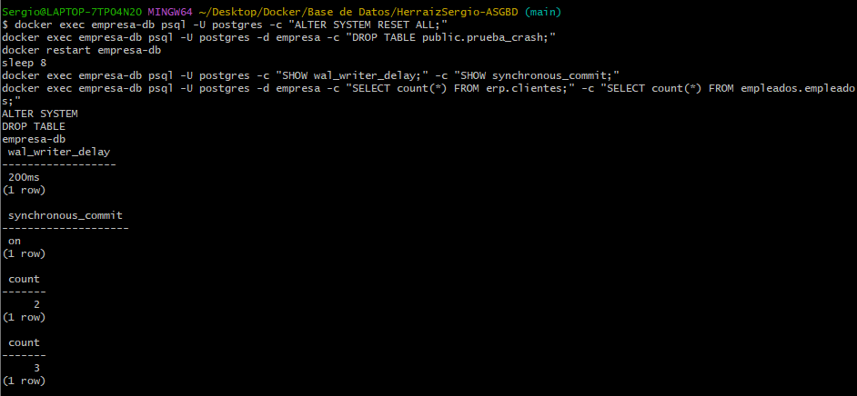

Vuelven `200ms` y `on`, y los datos reales siguen intactos (2 clientes y 3 empleados).

### 9.5 Observaciones y límites

- Con `docker kill -s KILL` desde fuera, el contenedor **no se reinició** (`Reinicios: 0`) y las comprobaciones posteriores fallaron con `container ... is not running`. Con `kill -QUIT 1` desde dentro sí se reinició. Mi hipótesis es que Docker trata `docker kill` como una parada manual y por eso no aplica la política, pero no lo he verificado. Por este motivo las pruebas se repitieron con `kill -QUIT 1`.
- En el primer intento válido del caso B la fila asíncrona se perdió. La pérdida depende de que la caída ocurra antes de que el WAL writer escriba, por lo que no es determinista.
- No se ha ejecutado el control inverso (la misma prueba con commit síncrono, que debería conservar la fila). Sin él, la pérdida observada no se aísla completamente de otros factores.
- `kill -QUIT` mata el proceso, no apaga la máquina. Un corte eléctrico real es más severo.

---

<a id="apartado-10"></a>
## 10. Problemas encontrados y cómo se resolvieron

| Problema | Causa | Solución |
|---|---|---|
| `Docker API ... dockerDesktopLinuxEngine not found` | Docker Desktop no estaba arrancado | Abrir Docker Desktop y esperar a *Engine running* |
| `Pool overlaps with other one on this address space` | Redes de otra asignatura (`p1_internal_net`, `p1_visitor_net`) ya ocupaban `172.30.0.0/24` y `172.31.0.0/24` | Comprobar que no tenían contenedores conectados y eliminarlas con `docker network rm` |
| Aviso de contenedores huérfanos (`erp_postgres`) | Otro proyecto también usaba el nombre `p1` | Renombrar el proyecto a `asgbd-p1`. **No** usar `--remove-orphans`, que borraría un contenedor ajeno |
| `container name "/empresa-db" is already in use` | Cambié `name:` del compose sin hacer antes `docker compose down -v` | Eliminar el contenedor, redes y volúmenes antiguos, y volver a montar |
| `volume is in use` al borrar volúmenes | Un contenedor parado seguía referenciándolos | Localizarlo con `docker ps -a --filter volume=...` y eliminarlo |
| `ls: cannot access 'C:/Program Files/Git/var/log/...'` | Git Bash convierte las rutas que empiezan por `/` | Usar `sh -c '...'` o `MSYS_NO_PATHCONV=1` |
| `bash: .env: No such file or directory` | Ejecuté `source .env` desde la raíz y no desde `p1/` | Ejecutarlo siempre desde `p1/` |
| 9 rechazos en vez de los 8 previstos | Una sesión adicional (la del DBA) ocupa una ranura | Medido con `pg_stat_activity` (apartado 4.3). Queda pendiente repetir la prueba sin sesión adicional |
| `container ... is not running` en la ampliación | `docker kill -s KILL` dejó el contenedor parado y la política de reinicio no actuó | Repetir las pruebas simulando la caída con `kill -QUIT 1` desde dentro del contenedor |

**Lección aprendida:** el nombre del proyecto de Compose se usa como prefijo de los volúmenes y como etiqueta de pertenencia de las redes. Cambiarlo con recursos ya creados los deja huérfanos, por lo que hay que hacer `docker compose down -v` **antes** de renombrar.

---

<a id="apartado-11"></a>
## 11. Limitaciones conocidas

| Limitación | Detalle |
|---|---|
| `local trust` | Cualquiera con acceso a `docker exec` entra como superusuario sin contraseña. La regla la necesita el arranque de la imagen, y solo es alcanzable desde el host de Docker |
| Sin cifrado de tráfico | Los logs muestran `no encryption`: SCRAM-SHA-256 protege la contraseña, pero las consultas y los datos viajan sin cifrar por la red interna. No se ha configurado TLS |
| Contraseña inicial compartida | Las cinco cuentas de personas se crean con la misma contraseña temporal; cada persona debe cambiarla en su primer acceso |
| Caducidad manual | `VALID UNTIL` no se renueva solo; hay que ejecutar `ALTER ROLE` (apartado 8.1) |
| Privilegios por defecto solo en `erp` | `ALTER DEFAULT PRIVILEGES` está definido para el esquema `erp`. Una tabla nueva en `empleados` no sería accesible para `rol_rrhh` hasta conceder los privilegios |
| Contraseñas en `docker run -e` | En las pruebas, `PGPASSWORD` se pasa como variable del contenedor temporal y puede verse con `docker inspect` mientras este existe. Es aceptable en un laboratorio local con contenedores `--rm` |
| Logs sin rotación por tamaño | Se crea un fichero por día, pero el volumen de logs crece sin límite |
| Cálculo de memoria | Las cifras marcadas como estimación no son mediciones |
| Cifra de conexiones | Véase la limitación del apartado 4.3 |

---

<a id="apartado-12"></a>
## 12. Preguntas previsibles para la defensa oral

| Pregunta | Dónde está la respuesta |
|---|---|
| ¿Cambia un parámetro en directo? | `ALTER SYSTEM SET work_mem` + `pg_reload_conf()` (apartado 3.5), o a nivel de sesión con `SET work_mem` |
| ¿Por qué `work_mem` se cambia sin reiniciar y `shared_buffers` no? | Columna `context` de `pg_settings`: `user` frente a `postmaster` (apartado 3.3) |
| ¿Cómo se da de alta a un analista? | `CREATE ROLE ... LOGIN ... VALID UNTIL ...` y `GRANT rol_analista TO ...` (apartado 8.4) |
| ¿Cómo se da de baja? | `REVOKE rol_analista FROM ...` (apartado 8.5) |
| ¿Por qué 55 conexiones? | Apartado 4.1 |
| ¿Por qué se admiten 51 y no 52? | Apartado 4.3: una ranura la ocupa la sesión del DBA; no se ha repetido sin ella |
| ¿Quién rechaza a los visitantes? | El SGBD, mediante `pg_hba.conf` (apartado 2) |
| ¿Por qué `local trust`? | Apartados 2.1 y 11 |
| ¿Se cifra el tráfico? | No, solo la contraseña (apartado 11) |
| ¿Por qué el ERP no puede borrar tablas? | No es propietario y no tiene `CREATE` (apartado 7.3) |
| ¿Cómo se protege el salario? | Privilegio por columna (apartado 8.1) |
| ¿Qué pasa con las transacciones confirmadas tras una caída? | Se recuperan del WAL, salvo con `synchronous_commit = off` (apartado 9) |